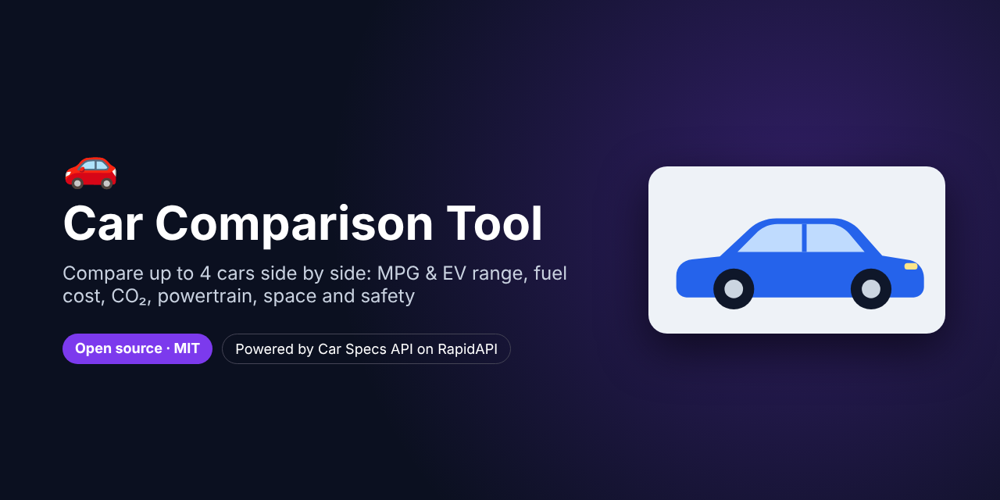
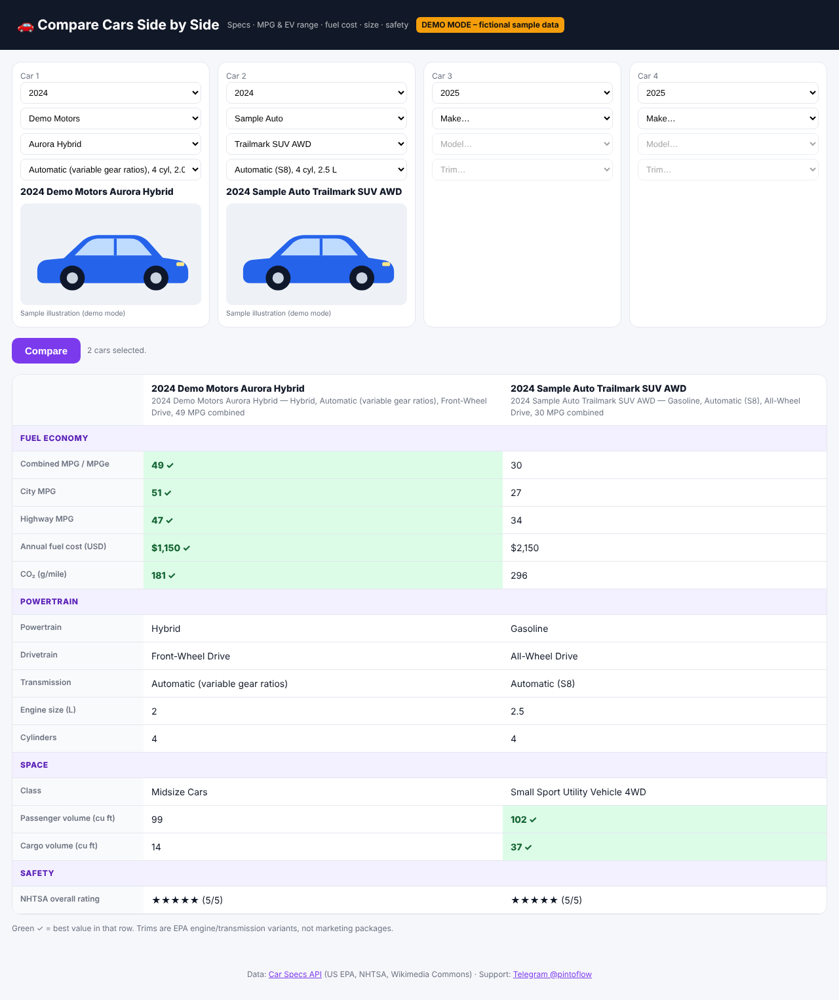

# Car Comparison Tool – Compare Cars Side by Side



> **For faster support reply, contact us on Telegram: [@pintoflow](https://t.me/pintoflow)**

An open-source, self-hosted **car comparison tool**. Pick up to **4 cars** by year, make, model and engine/transmission and compare them **side by side**:

- ⛽ **Combined, city and highway MPG** (or MPGe), **EV range**, **annual fuel cost** and **CO₂**
- ⚙️ **Powertrain** (gas, hybrid, plug-in, electric), drivetrain, transmission, engine size and cylinders
- 📦 Vehicle class, **passenger and cargo volume**
- ⭐ **NHTSA overall safety rating**
- 📷 A photo of each car, with its licence attribution

The **best value in each row is highlighted**. It covers every US car, SUV, van and light truck from **1984 to next year**. Node.js with **zero dependencies**.

Powered by the **[Car Specs API](https://rapidapi.com/belchiorarkad-FqvHs2EDOtP/api/car-specs-api)** on RapidAPI.



<sub>Screenshot in demo mode with fictional makes and models.</sub>

---

## Why this exists

"Compare cars side by side" and "[car A] vs [car B]" searches are a huge share of car-buying research. Comparison pages drive traffic for car blogs, dealers and affiliate sites. This tool gives you that feature, with your own branding, in one small server.

## Quick start

```bash
git clone https://github.com/BelNaruto/car-comparison-tool.git
cd car-comparison-tool

node server.js                                 # demo mode (fictional sample data)
RAPIDAPI_KEY=your_rapidapi_key node server.js  # live data
```

Open **http://localhost:3000**. Requires Node.js 18 or newer, and there's nothing to install.

Get a key: **https://rapidapi.com/belchiorarkad-FqvHs2EDOtP/api/car-specs-api**

## API endpoints used

| Endpoint | Used for |
|---|---|
| `GET /makes?year=` | Makes that have spec data for that year (no dead ends) |
| `GET /models?make=&year=&source=epa` | Exact model names that match the trims |
| `GET /trims?make=&model=&year=` | Engine and transmission variants, each with a stable `id` |
| `GET /compare?ids=41189,47069` | 2–4 trims side by side; each comparable row has a `bestId` |
| `GET /images?make=&model=&year=` | Licensed photos with ready-made `attribution` |
| `GET /safety-ratings?make=&model=&year=` | NHTSA star ratings |

## Ideas

- **"X vs Y" SEO pages**: pre-render popular matchups for your car blog
- An **"add to compare"** button on a dealer or classifieds site
- An **EV vs gas** comparison widget
- A **fleet buying** tool that compares running costs

## Deploy

Deploy to **Google Cloud Run, Render, Railway, Fly.io** or any VPS with the start command `node server.js` and the env var `RAPIDAPI_KEY`. Specs for past model years never change, so the server caches responses for 6 hours.

## Related projects

- 🔎 [Free VIN Decoder](https://github.com/BelNaruto/free-vin-decoder): full specs, MPG, safety and photos from a VIN
- ⛽ [Car Fuel Cost Calculator](https://github.com/BelNaruto/car-fuel-cost-calculator): gas vs hybrid vs electric running costs
- 📘 [Car Specs API docs and examples](https://github.com/BelNaruto/car-specs-api)

## Support

> **For faster support reply, contact us on Telegram: [@pintoflow](https://t.me/pintoflow)**

API: https://rapidapi.com/belchiorarkad-FqvHs2EDOtP/api/car-specs-api

---

MIT License. Data from US EPA, NHTSA and Wikimedia Commons. Brand names and logos belong to their owners.

**Keywords:** compare cars, car comparison, compare cars side by side, car vs car, car specs comparison, mpg comparison, ev vs gas, suv comparison, car comparison tool, car specs api
